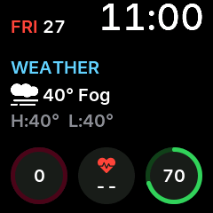
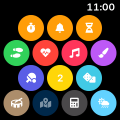
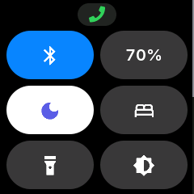
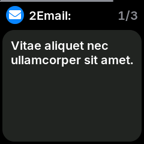
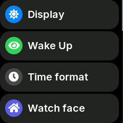

# PineGlass

PineGlass is firmware for the [PineTime](https://pine64.org/devices/pinetime/) smartwatch with an interface inspired by watchOS. It is a fork of [InfiniTime](https://github.com/InfiniTimeOrg/InfiniTime) and keeps all of its apps, Bluetooth features, and companion app support.

<p>





</p>

## What is different from InfiniTime

- **Modular watch face.** Date and time at the top, a large weather module, and round complications for steps, heart rate and battery. Tap a complication to open its app. Modular is the default face, and every InfiniTime face is still available.
- **Honeycomb app grid.** Apps are colored circles in staggered rows. Icons near the center are larger and shrink toward the edges. Settings is in the grid as a gray gear.
- **Control Center.** Two columns of pill buttons: Bluetooth, battery, Do Not Disturb, Sleep, flashlight, brightness, Settings, and Lock Screen.
- **Notification cards.** Each card shows an app icon in the category color, the sender, and the message on a rounded card.
- **System look.** Black background, a dark color palette, rounded controls, and the Inter typeface with antialiased text.

## Gestures

| On the watch face | Action |
|---|---|
| Press the button | Open Control Center |
| Swipe up | Open the app grid |
| Swipe down | Open notifications |
| Swipe left or right | Change the watch face |
| Double tap | Turn the screen off |

Inside an app, press the button to go back. Hold the button to return to the watch face.

## Install

1. Download `pineglass-*-dfu.zip` from the [releases](https://github.com/Project516/PineGlass/releases).
2. Flash it with a companion app: [InfiniLink](https://github.com/InfiniTimeOrg/InfiniLink) on iOS, [Gadgetbridge](https://gadgetbridge.org/) on Android, or [ITD](https://gitea.elara.ws/Elara6331/itd) or [Siglo](https://github.com/alexr4535/siglo) on Linux.
3. After the watch restarts, open Settings > Firmware and tap Validate. If you do not validate it, the watch goes back to the previous firmware on the next restart.

The watch keeps the Bluetooth name "InfiniTime", so companion apps find it the same way as before. To go back to InfiniTime, flash an [InfiniTime release](https://github.com/InfiniTimeOrg/InfiniTime/releases) the same way.

## Build

PineGlass builds the same way as InfiniTime. With Docker or Podman:

```sh
git clone https://github.com/Project516/PineGlass.git
cd PineGlass
git submodule update --init
docker run --rm -it -v ${PWD}:/sources --user $(id -u):$(id -g) infinitime/infinitime-build
```

The firmware files are written to `build/output`. See the [InfiniTime build docs](doc/buildAndProgram.md) for other ways to build, and [InfiniSim](https://github.com/InfiniTimeOrg/InfiniSim) to run the interface on a computer.

## Credits and licenses

PineGlass is based on InfiniTime by the InfiniTime contributors and is licensed under the GPLv3, like InfiniTime. See [LICENSE](LICENSE).

- [Inter](https://rsms.me/inter/) typeface, SIL Open Font License ([Inter-LICENSE.txt](src/displayapp/fonts/Inter-LICENSE.txt))
- [Font Awesome](https://fontawesome.com/) icons, SIL Open Font License
- [Material Icons](https://fonts.google.com/icons), Apache License 2.0

Apple, Apple Watch and watchOS are trademarks of Apple Inc. PineGlass is not affiliated with, endorsed by, or sponsored by Apple. It contains no Apple code, fonts, icons or artwork.
